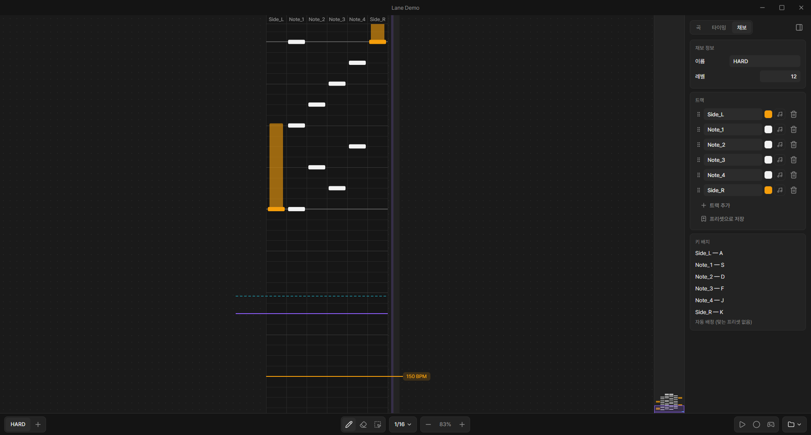
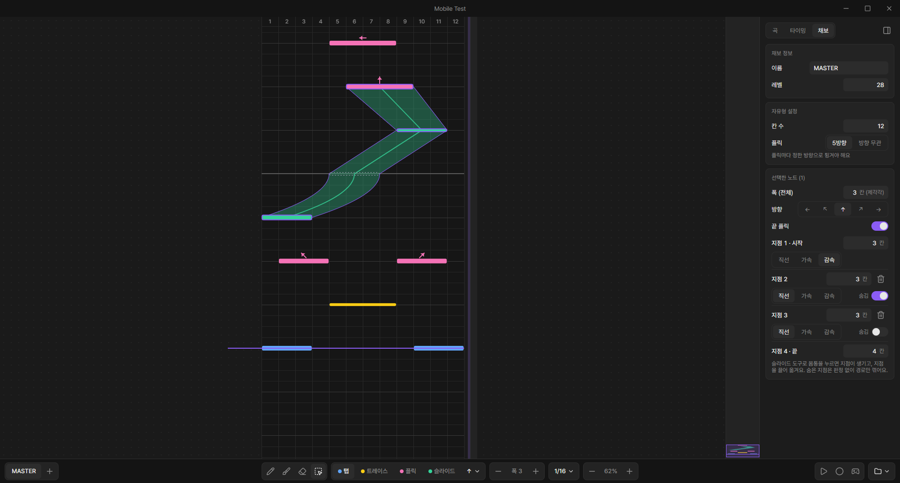
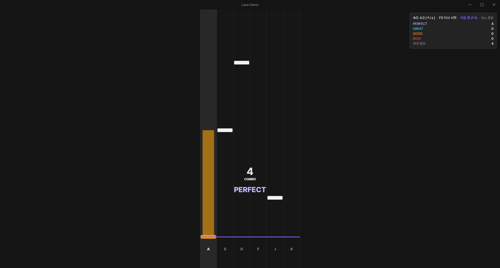
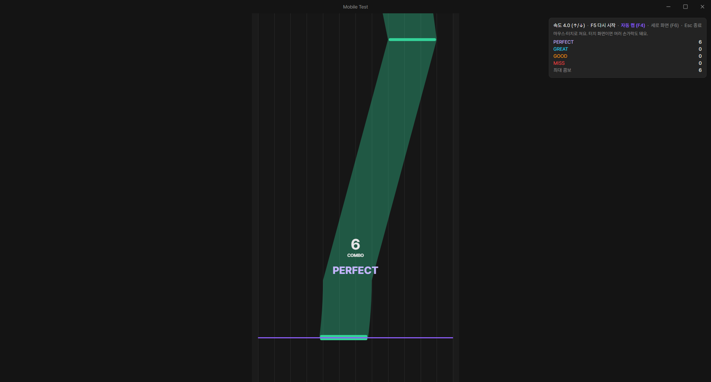

[한국어](README.md) | **English**

# RCM Chart Editor

A Windows desktop app for making rhythm game charts. Load a song, sync the beat, place notes, and play your chart right away in a built-in test play.

RCM makes two kinds of charts. **Vertical lane** charts have notes that fall down lanes, as in DJMAX. **Mobile (free-layout) charts (beta)** give every note a horizontal position and width, as in Project Sekai.

**[⬇ Download the latest version](https://github.com/glglekdy/RCM/releases/latest)**: get `RCM-Setup-x.y.z.exe` and run it.

> The app's interface is currently in Korean only.

## Features

### Lane charts
- Set up 1–16 tracks (lanes) however you like. Rename, recolor, and reorder them, or add gimmick tracks that are never judged.
- Two note types, **tap** and **hold**: click to place a tap, or drag upward to make a hold.
- Save track layouts and key bindings as **track presets**. You can also start from a DJMAX, EZ2ON, Muse Dash, or osu!mania layout.
- **Live recording** turns the keys you press along with the music into notes.

### Mobile (free-layout) charts (beta)
- Place notes on horizontal columns instead of lanes (12 by default, 1–32 per chart). Each note has its own position and width.
- Four note types: **tap**, **trace**, **flick**, and **slide**. To place a flick, hold the mouse button and drag it in the direction you want.
- Slides connect points. Each point can have its own curve (linear, ease-in, ease-out), and points can be hidden. A slide can also end in a flick.
- **Brush tool**: hold and drag to lay notes along your stroke. With the slide type selected, the brush turns your stroke into one slide that follows the path.

### Both chart types
- **Timing**: set the offset against the waveform, and tap <kbd>T</kbd> to the beat during playback to measure the BPM. Mid-song BPM changes and scroll speed changes are supported.
- **Test play**: play from the playhead like the real game and check judgements and combo. Autoplay lets you just watch. Mobile charts are played with the mouse or touch, in a portrait or landscape phone frame.
- Copy, paste, mirror, undo, guide markers, and a minimap are all included.
- The app tells you when a new version is out and can update itself.

| Lane test play | Mobile test play |
|---|---|
|  |  |

## Getting started

1. Download `RCM-Setup-x.y.z.exe` from the [latest release](https://github.com/glglekdy/RCM/releases/latest) and install it.
   The installer is not code-signed, so Windows may show a "Windows protected your PC" warning. Click **More info → Run anyway**.
2. Click **새 프로젝트** (New project) and enter the song title, music file (ogg, mp3, or wav), BPM, and first difficulty. Choose lane or mobile (free-layout) as the chart type.
3. Place notes, press <kbd>F5</kbd> to test play, and press <kbd>Ctrl</kbd>+<kbd>S</kbd> to save.

For detailed instructions and shortcuts, see **유저 가이드** (User guide) in the app's left menu.

## Using your charts in a game

Each song is saved as one folder. The folder holds the song info (`song.json`), one chart per difficulty (`name.chart.json`), and the music file, so you can drop the whole folder into your game.

How a game reads these files is documented in the app's **AI 가이드** (AI guide) menu and in [CHART_FORMAT_GUIDE.md](docs/CHART_FORMAT_GUIDE.md). The guide includes the timing formulas, judgement rules, and reference code. You can hand it to an AI agent such as Claude and have it build the game. The guide itself is written in Korean.

> **Credit rule**: games that use charts made with RCM must put a **`Made with RCM`** button in their credits. The button should open `https://github.com/glglekdy/RCM/tags`.

## Copyright notice

RCM Chart Editor is a tool for making charts. You alone are responsible for checking the copyright of any music, images, or other content you load or use in the editor, and for getting permission to use it. The developer takes no responsibility for any copyright issues arising from using copyrighted content or distributing charts made with it.

## For developers

To build the app or change the code, see [docs/DEVELOPMENT.md](docs/DEVELOPMENT.md) (in Korean).
